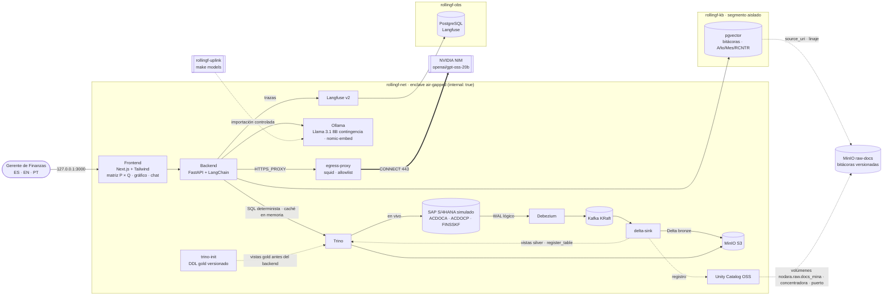

# Nodara GenAI Financial Twin

**Rolling Forecast de OPEX C1 a 18 meses para la cadena de valor de la Gran Minería, con detalle precio × cantidad
(P × Q) por cuenta de mayor. Es un AI Lakehouse air-gapped en el que Trino calcula y la IA explica.**

El Gerente de Finanzas ve los 12 centros de costo del OPEX C1, agrupados en mina, concentradora, lixiviación y
puerto. Cada línea de gasto es una cuenta de mayor (`RACCT`) con su costo (`KSL`), su cantidad física (`MSL`) y su
unidad (kg, L, piezas, horas, kWh, m³, t). Trino calcula de forma determinista, sobre el lakehouse:
- el **consumo específico** de cada insumo (por ejemplo, piezas de acero o litros de diésel por metro perforado),
  cruzando la cantidad con el impulsor físico del centro de costo (`FINSSKF`);
- el **precio unitario** real y presupuestado de cada insumo;
- la **desviación real − presupuesto (`BUDG`)** de cada cuenta, descompuesta sobre un presupuesto flexible en efecto
  **Precio (P)**, efecto **Eficiencia (Q)**, efecto **Volumen** y **Gasto** (cuentas sin cantidad);
- el OPEX unitario del centro de costo y los 18 meses del rolling forecast (`RF18M`).

En el chat el Gerente pregunta, por ejemplo, *"¿Qué cuenta (RACCT) originó la desviación del mes y fue efecto precio o
eficiencia?"*. El LLM **no calcula**: recibe la matriz P × Q y el ranking de efectos que calculó Trino, más las
bitácoras de justificación que pgvector filtra por **Año, Mes y RCNTR**. Con eso nombra la cuenta y el efecto que
originan la desviación y la explica en español, inglés o portugués. Un control determinista verifica que cada número
de la respuesta provenga de Trino.

El enclave no tiene salida a Internet. La única excepción es un gateway con allowlist hacia NVIDIA. Cada pregunta
queda trazada en Langfuse, autoalojado.

| Indicador (validado con `make smoke` y `make ui-test`) | Resultado |
|---|---|
| Servicios del stack | 14 servicios `healthy` + 3 jobs de inicialización `exit 0` (MinIO, Debezium y `trino-init`, que publica gold antes del backend) |
| Modelo SAP | P × Q en campos SAP reales: ACDOCA `KSL` + `MSL`/`RUNIT`; ACDOCP `KSL` + `VMSL`/`RVUNIT` + `KPRICE` + parte fija `KFSL`/`VMFSL`. ACDOCA cuadrado por documento; plan con `KSL = KPRICE × VMSL` exacto |
| Seed de producción | 12 centros de costo, 59 líneas centro × cuenta (24 cuentas, 7 unidades), 6 meses reales + `BUDG` y 18 de `RF18M`; 714 documentos con consumos de bodega semanales; OPEX C1 de ~USD 46 M al mes |
| CDC | Debezium captura las 3 tablas. Trino ve las mismas filas en S/4 en vivo, en bronze y en silver (1.428 / 1.416 / 360) |
| Vista master `vw_opex_c1_pxq` | Una fila por versión, mes, RCNTR y RACCT (1.770 filas = 1.770 grupos): nunca suma unidades distintas. Con impulsor 0 (puerto, 2026-10) el consumo específico y el costo unitario quedan en NULL, sin error de división |
| P × Q determinista | Las 59 líneas de 2026-10 (costo, efectos P/Q/volumen/gasto, consumo específico y precio) y el OPEX unitario de 24 meses de los 12 centros son idénticos en Trino y en PostgreSQL |
| IA explicativa (NIM `openai/gpt-oss-20b`) | 8,7–23,2 s por respuesta en las 4 anomalías (ES/EN/PT) y el efecto dominó; 3 de 5 bajo el objetivo de 15 s. El análisis de Trino sale del caché (0 ms), así que el tiempo es la generación de NIM, que varía con la carga de NVIDIA (6,7–9,3 s en la corrida anterior). La IA abre con la cuenta y el efecto de origen que calculó Trino («Origen: ACEROS · efecto Eficiencia (Q)», «REACTIVOS · efecto Precio (P)», «LABOR · Efficiency (Q)», «direcionador TONEMB (Volume)») y lo confirma con la bitácora filtrada. En Relaves explica la caída del tratamiento con la bitácora del SAG. El 100 % de las cifras está anclado a Trino (27/27, 28/28, 29/29, 26/26 y 25/25) |
| Contingencia local (Llama 3.1 8B en GPU) | 18,1 s; nombra el mismo origen (ACEROS · Eficiencia (Q)) con el 100 % de las cifras ancladas (32/32) |
| RAG con metadatos | 4 bitácoras de justificación (17 fragmentos), una por anomalía. Cada vector guarda Año/Mes/RCNTR y su alcance de RCNTR (NOT NULL + CHECK). La bitácora del molino SAG cubre también Relaves y Filtrado (efecto dominó); un centro sin anomalía no recibe textos |
| Tiempo real | Un despacho de diésel contabilizado en S/4 llega a silver en 11 s (latencia CDC 3,1 s; el `delta-sink` confirma en Delta cada 5 s). El commit invalida el caché y la API entrega el OPEX nuevo de `MIN_TRAN` |
| Caché del backend | 50 consultas precalentadas al arrancar; el análisis de cada pregunta tarda 0 ms (1,5–3,7 s sin caché) y la matriz C1 responde en 7 ms. Las cifras son las mismas que sin caché |
| Observabilidad | 1 traza por pregunta en Langfuse (`gerente_finanzas@nodara.com`): generación LLM + spans de Trino y pgvector |
| Air-gap y egress | Solo `integrate.api.nvidia.com` sale por el gateway; `pypi.org`, `example.com` y las APIs de FX se deniegan |

## Cadena de valor OPEX C1 (seed de producción)

Sociedad y área de control `CL01`; moneda funcional y de grupo USD. Seis meses reales (2026-05 → 2026-10; el mes
actual, 2026-10, cierra el 27) con su presupuesto base, y 18 meses de rolling forecast (2026-11 → 2028-04).

| Área | Centro de costo | Impulsor (FINSSKF) | Cuentas de gasto (RACCT · unidad) |
|---|---|---|---|
| Mina | `MIN_PERF` Perforación | `METPER` metros perforados (m) | ACEROS (PC), DIESEL (L), LABOR (HR), MANTEN (HR), DEPREC (USD) |
| Mina | `MIN_TRON` Tronadura | `TONTRO` toneladas tronadas (t) | EXPLOSIV (KG), ACCESOR (PC), SERVIC (HR), LABOR (HR) |
| Mina | `MIN_CARG` Carguío | `TONCAR` toneladas cargadas (t) | ENERGIA (KWH), DIESEL (L), REPUEST (PC), LABOR (HR), DEPREC (USD) |
| Mina | `MIN_TRAN` Transporte | `TONMOV` toneladas transportadas (t) | DIESEL (L), NEUMAT (PC), REPUEST (PC), LABOR (HR), DEPREC (USD) |
| Concentradora | `CON_MOLI` Molienda | `TONMOL` toneladas molidas (t) | ENERGIA (KWH), BOLAS (KG), REVEST (KG), LABOR (HR), MANTEN (HR) |
| Concentradora | `CON_FLOT` Flotación | `TONFLO` toneladas flotadas (t) | REACTIVOS (KG), CAL (KG), ENERGIA (KWH), LABOR (HR), MANTEN (HR) |
| Concentradora | `CON_RELA` Relaves | `TONREL` toneladas de relave (t) | ENERGIA (KWH), FLOCUL (KG), AGUA (M3), LABOR (HR), MANTEN (HR) |
| Lixiviación | `LIX_RIEG` Riego de pilas | `TONAPI` toneladas bajo riego (t) | ACIDO (TO), AGUA (M3), ENERGIA (KWH), LABOR (HR), MANTEN (HR) |
| Lixiviación | `LIX_SX` Extracción por solventes | `M3PLS` PLS tratado (m³) | EXTRACT (KG), DILUY (L), ENERGIA (KWH), LABOR (HR), MANTEN (HR) |
| Lixiviación | `LIX_EW` Electro-obtención | `TONCAT` toneladas de cátodo (t) | ENERGIA (KWH), ADITIVOS (KG), ANODOS (PC), LABOR (HR), MANTEN (HR) |
| Puerto | `PTO_FILT` Filtrado de concentrado | `TONFIL` toneladas filtradas (WMT) | ENERGIA (KWH), TELAS (PC), AGUA (M3), LABOR (HR), MANTEN (HR) |
| Puerto | `PTO_EMBA` Embarque | `TONEMB` toneladas embarcadas (WMT) | ENERGIA (KWH, fija + variable), ALMAC (USD), LABOR (HR), MANTEN (HR), DEPREC (USD) |

Cómo se construyó el seed (`init-scripts/s4hana/02-seed.sql`):
- **Coherencia física.** Cada cantidad sale del impulsor: consumo específico × impulsor para las líneas variables,
  capacidad diaria × días para las fijas. El mineral fluye por la cadena: cargado = transportado, flotación =
  molienda, relaves 97 % y concentrado 3,3 % de lo molido, y los embarques siguen al concentrado.
- **P × Q exacto.** Cada documento cumple `KSL = precio × MSL`; los consumos de bodega se contabilizan cuatro veces
  al mes y el plan cumple `KSL = KPRICE × VMSL`.
- **Precios.** El diésel, los explosivos y el ácido siguen un índice mensual (± 2 %); los contratos (energía,
  salarios, servicios, repuestos) quedan al precio del presupuesto.
- **Reproducible.** El ruido operacional es determinista (MD5), sin `random()`.

**Anomalías de 2026-10** (cada una con su bitácora de justificación en pgvector, varias secciones, metadatos Año 2026
· Mes 10 · RCNTR). Las cifras son las que calcula Trino:

| Centro | Evento (bitácora) | Origen de la desviación | Detalle P × Q |
|---|---|---|---|
| `MIN_PERF` | Desgaste prematuro de aceros por roca abrasiva en la fase 7 (`BIT-PERF-2026-10`) | `ACEROS` · Eficiencia (Q) +USD 363.009 | 0,0006469 vs. 0,0004167 PC/m (+55,3 %) al mismo precio (USD 10.850 por broca); el diésel por metro queda en línea. OPEX +14,7 %; 18,37 vs. 15,64 USD/m |
| `CON_FLOT` | Nueva tarifa del proveedor de xantato (`BIT-FLOT-2026-10`) | `REACTIVOS` · Precio (P) +USD 58.108 | 4,05 vs. 3,18 USD/kg (+27,4 %) con la dosificación en estándar (23,7 vs. 23,5 g/t); el OPEX total baja 3,8 % por el menor tratamiento (volumen) |
| `CON_MOLI` | Falla de revestimientos del molino SAG: 58 h detenido (`BIT-MOLI-2026-10`) | `LABOR` · Eficiencia (Q) +USD 85.722, más Precio (P) +USD 29.572 | 8.599 vs. 6.231 horas hombre por horas extra, a 39,64 vs. 36,20 USD/h por recargo; el tratamiento cae 9 % y arrastra flotación, relaves y filtrado |
| `PTO_EMBA` | Ningún buque atracó en octubre (`BIT-EMBA-2026-10`) | Impulsor `TONEMB` en 0 (Volumen) | 0 vs. 102.300 WMT: OPEX unitario no calculable; LABOR y MANTEN iguales al presupuesto (fijos) |

**Efecto dominó.** La bitácora del molino SAG declara en su front matter `rcntr_scope: CON_MOLI, CON_RELA,
PTO_FILT`, así que también cubre a Relaves y Filtrado. Esos centros bajan su tratamiento por falta de mineral, no por
fallas propias:

| Centro | Impulsor real vs. presupuesto | OPEX unitario |
|---|---|---|
| `CON_RELA` | 2.736.370 vs. 3.007.000 t (−9,0 %) | +1,0 % |
| `PTO_FILT` | 91.259 vs. 102.300 WMT (−10,8 %) | +5,1 % |

Al preguntar por ellos, la IA recibe la sección «Efecto aguas abajo» y explica la causa.

`sap.simulate_activity(n)` (`make simulate`) contabiliza despachos de diésel de la flota de transporte en el período
abierto, al precio real del mes; el gráfico y la matriz los reflejan en vivo vía CDC.

## Modelo de datos financiero (SAP S/4HANA simulado)

| Tabla | Clave | Campos usados | Rol |
|---|---|---|---|
| `ACDOCA` Universal Journal | `RCLNT, RLDNR, RBUKRS, GJAHR, BELNR, DOCLN` | `POPER`, `FISCYEARPER`, `PERIV`, `BUDAT`, `BLART` (WA, WE, SA, AF), `RACCT`, `KOART`, `DRCRK`, `RWCUR/WSL`, `RHCUR/HSL`, **`RKCUR/KSL`**, **`MSL`/`RUNIT`**, `KOKRS`, `RCNTR`, `PRCTR`, `MATNR`, `SGTXT`, `USNAM` | Real (pasado): costo y cantidad por línea, cuadrado por documento |
| `ACDOCP` Plan Data Line Items | `RCLNT, REQTSN, DATAPAKID, RECORD` | `RYEAR`, `RLDNR`, `RBUKRS`, **`CATEGORY`**, `RACCT`, `RWCUR/WSL`, `RHCUR/HSL`, `RKCUR/KSL`, **`VMSL`/`RVUNIT`**, **`KPRICE`** (`WPRICE`, `HPRICE`), parte fija **`KFSL`** (`WFSL`, `HFSL`) y **`VMFSL`**, `KOKRS`, `RCNTR`, `PRCTR`, `PERIV`, `POPER`, `FISCYEARPER`, `BUDAT`, `SGTXT`, `USNAM` | Presupuesto base (`BUDG`, meses reales) y forecast (`RF18M`, futuro) en P × Q |
| `FINSSKF` GL statistical key figures | `RCLNT, STAGR, RECID, DATE_FROM` | `GRTYP`, `MSL`, `RUNIT` (`M`, `TO`, `M3`, `WMT`), `TIMESTAMP`, `RBUKRS`, `RRCTY`, `CATEGORY`, `RCNTR`, `PRCTR`, `KOKRS`, `LOGSYS` | Impulsor de cada centro de costo: real (`RRCTY 0`) y plan (`RRCTY 1` + `CATEGORY`) |

> **Campos reales, no inventados.** La ficha de `ACDOCP` que entregó el Arquitecto no tiene `MSL`, `RUNIT` ni `RUOM`:
> su cantidad es `VMSL` (cantidad de valoración) en `RVUNIT`, con precio `KPRICE` y parte fija `KFSL`/`VMFSL`. En
> `ACDOCA` la cantidad estándar es `MSL` en `RUNIT`. La vista gold expone ambas con los nombres del negocio: `msl` y
> `ruom`. Tampoco existe `RVERS`: la versión del plan es `CATEGORY` (`BUDG` presupuesto base, `RF18M` rolling forecast).

## Arquitectura



| Capa | Componente | Versión | Host (127.0.0.1) |
|---|---|---|---|
| Transaccional | SAP S/4HANA simulado: PostgreSQL relacional, esquema `sap` (3 tablas financieras) | postgres 16.15 | `S4_DB_PORT` |
| CDC | Debezium Connect (pgoutput) + Kafka KRaft | 3.6.3 / 4.3.2 | Debezium REST 8083 |
| Lakehouse | MinIO (`lakehouse` + `raw-docs`) + Delta Lake (bronze + vistas silver + vistas gold P × Q) + Unity Catalog OSS + Trino | 2026-08 / delta-rs 1.6 / 0.7.0 / 484 | MinIO 9000/9001 · UC 8081 · Trino 8080 |
| Conocimiento | PostgreSQL + pgvector aislado (solo bitácoras, metadatos Año/Mes/RCNTR) | pgvector 0.8.7 | 5433 |
| IA y backend | FastAPI + LangChain 0.3 → NVIDIA NIM (`openai/gpt-oss-20b`) con contingencia Ollama (Llama 3.1 8B); embeddings locales | Ollama 0.40.11 | no publicado |
| Salida controlada | Gateway squid: default deny, solo CONNECT 443 a `integrate.api.nvidia.com` | squid 6.6 | no publicado |
| Observabilidad GenAI | Langfuse v2 autoalojado (SDK v2 + `CallbackHandler`) | 2.95.11 / SDK 2.60.10 | 3001 |
| Frontend | Next.js + TailwindCSS (ES/EN/PT, selector por área, KPIs vs. presupuesto, gráfico SVG real + presupuesto + plan, matriz P × Q expandible, chat IA, selector de motor) | Next 16.4 · Tailwind 4.3 | 3000 |

### Capa gold P × Q (Trino) y control de cifras

- **Silver.** `delta-sink` crea por tabla una vista `lakehouse.silver.<tabla>` con el estado vigente: última imagen
  CDC por clave primaria (tomada de la key de Debezium) y sin registros borrados. El backend nunca lee bronze.
- **`lakehouse.gold.vw_opex_c1_pxq`** (vista master). Tiene una fila por versión (`ACTUAL`, `BUDG`, `RF18M`), mes,
  `RCNTR` y `RACCT`, agrupada siempre por cuenta para no sumar unidades distintas. Columnas:
  - `ksl`, `msl` y `ruom`, más la parte fija `fixed_ksl`/`fixed_msl` del plan;
  - el impulsor del centro de costo (`stagr`, `driver_qty`);
  - `unit_price = KSL / MSL`, `specific_consumption = MSL / impulsor` y `cost_per_driver_unit = KSL / impulsor`.

  Toda división usa `nullif`, así que un impulsor en 0 da NULL y nunca un error.
- **`lakehouse.gold.vw_opex_c1_pxq_variance`.** Compara real y `BUDG` por línea sobre un presupuesto flexible: la parte
  fija (`KFSL`/`VMFSL`) no se mueve y la variable sigue al impulsor (`actividad = impulsor real / presupuesto`).
  - Precio (P) = KSL real − P ppto × Q real.
  - Eficiencia (Q) = P ppto × (Q real − Q flexible).
  - Volumen = costo flexible − presupuesto.
  - Gasto = real − costo flexible, en cuentas sin cantidad.

  Los cuatro efectos suman exactamente la desviación.
- **Quién publica las vistas.** El job de una sola ejecución `trino-init` (misma imagen de Trino) aplica el DDL
  versionado de `lakehouse/trino/gold/*.sql`: espera a que `delta-sink` cree las vistas silver y publica gold. El
  backend depende de que ese job termine (`service_completed_successfully`) y **nunca ejecuta DDL**; el smoke lo
  verifica.
- **Qué calcula el backend.** Sobre esas vistas, `backend/app/lakehouse.py` calcula:
  - la serie mensual;
  - el análisis de un centro, con el **ranking de efectos desfavorables** cuyo primero es el origen de la desviación;
  - la matriz C1 de todos los centros;
  - el horizonte del plan.
- **Caché en memoria.** Cada resultado queda en caché con la versión Delta de las tablas bronze (`$history`, solo
  metadatos, sondeada como máximo cada 2 s). Un commit CDC nuevo invalida el caché, así que nunca se sirve una cifra
  vieja. Al arrancar, el backend precalienta la matriz y los 12 centros. `/api/status` publica aciertos y cálculos.
- **Python y la UI solo formatean.** Las cifras llegan al LLM ya calculadas, en el formato del idioma de respuesta.
- **Control de cifras** (`backend/app/figures.py`): contrasta cada número de la respuesta con el contexto (Trino,
  bitácoras y pregunta). Admite formatos `4.207.000` / `4,207,000` / `4 207 000`, redondeos y escalas. Los números no
  anclados se informan en la UI y en Langfuse.

### Flujo de una pregunta

1. La UI envía `{"question", "language": "ES|EN|PT", "engine": "nim|ollama", "rcntr"}`. `period` (`YYYY-MM`) es
   opcional; por defecto se usa el último mes real.
2. Se abre una traza de Langfuse y Trino calcula la matriz P × Q del centro de costo, el ranking de efectos y el
   horizonte del plan (span *trino · OPEX unitario*). Si el lakehouse no cambió desde el último cálculo, el resultado
   sale del caché en memoria.
3. `nomic-embed-text` (local) vectoriza la pregunta. pgvector filtra por `gjahr`, `monat` y por el `rcntr` dentro
   del alcance de cada bitácora (`rcntr_scope`), y recién entonces ordena por similitud (span *retrieval*).
4. El LLM responde con un *system prompt* por idioma que le prohíbe calcular. Abre con una línea fija, por ejemplo
   «Origen: ACEROS · efecto Eficiencia (Q)». Si ninguna cuenta tiene efectos desfavorables, el bloque de Trino nombra
   el impulsor como origen («Origen: impulsor TONEMB (Volumen)»). Después vienen la desviación del mes, la causa
   (bitácora citada `[DOC-ID §sección]`), el impacto en el forecast y las fuentes.
5. Controles deterministas: **idioma** (re-traducción si se desvió) y **cifras** (`figures_check`).
6. La respuesta trae el análisis de Trino (líneas P × Q y origen), las bitácoras con sus metadatos, el filtro, el
   motor, los intentos, la traza y los tiempos por etapa.

### Pipeline en tiempo real

`S/4 (WAL) → Debezium → Kafka (s4hana.sap.*) → delta-sink → s3://lakehouse/bronze/<tabla>` (Delta append-only con
`_cdc_op`, `_source_ts`, `_source_lsn` e `_ingested_at`) → vista silver → vistas gold → Trino → API → UI. El gráfico
se refresca cada 20 s y la matriz cada 30 s. Para generar actividad: `make simulate n=10`.

### Raw layer (gobierno de datos)

- **Fuente única**: los originales (`knowledge/raw-docs/<origen>/*.md`, orígenes `mina`, `concentradora` y
  `puerto`), con front matter obligatorio `gjahr`, `monat` y `rcntr`. `rcntr_scope` es opcional: lista los centros que
  explica la bitácora y, si falta, vale el propio `rcntr`. `make kb-seed` genera el seed de pgvector y falla si falta
  un metadato o si un RCNTR excede los 10 caracteres de SAP.
- **MinIO `raw-docs`**: el bucket está versionado y un archivo solo se sube si cambió su SHA-256. Cada objeto lleva los
  metadatos `Sha256`, `Classification`, `Language`, `Rcntr`, `Gjahr` y `Monat`.
- **Catálogo y linaje**: un volumen EXTERNAL `nodara.raw.docs_<origen>` por origen en Unity Catalog.
  `kb.documents.source_uri` apunta al original y `make smoke` verifica índice ⊆ raw.

## Air-gap: diseño de redes

| Red | Tipo | Quién | Propósito |
|---|---|---|---|
| `rollingf-net` | `internal: true` | todo el stack | plano de datos e IA; sin egress |
| `rollingf-kb` | `internal: true` | backend + vector-db | base de conocimiento aislada |
| `rollingf-obs` | `internal: true` | langfuse + langfuse-db | base de datos de trazas aislada |
| `rollingf-egress` | bridge | solo `egress-proxy` | única salida a Internet en runtime (allowlist: NVIDIA) |
| `rollingf-edge` | bridge | solo servicios con puerto publicado | acceso del operador (bind 127.0.0.1) |
| `rollingf-uplink` | bridge | `ollama-bootstrap` (perfil) | única vía de entrada de modelos (`make models`) |

Ollama, el backend, Kafka y delta-sink nunca tocan `rollingf-edge` ni tienen salida directa. El backend sale solo por
`egress-proxy` hacia NVIDIA.

## Puesta en marcha

Requisitos: Docker Engine/Desktop con Compose v2, `make`, `curl` y `python3`. Recursos recomendados: 8 vCPU y 16 GB de
RAM. Este proyecto usa los mismos puertos que `nodara-br-rag`: si ese stack está corriendo, deténlo antes
(`docker compose stop` en su carpeta).

```bash
make env         # crea .env con secretos aleatorios y claves de Langfuse; NVIDIA_API_KEY se completa a mano (opcional)
make preflight   # detecta colisiones de puertos (Linux/WSL + Windows)
make up          # build + up del stack completo; espera a que todo esté healthy
make models      # importa Llama 3.1 + nomic-embed-text vía uplink (~5 GB)
                 #   o sin Internet: make models from=nodara-br-rag_ollama-models (copia offline desde otro volumen)
make embed       # vectoriza las bitácoras en pgvector
make smoke       # re-siembra (make fresh) y corre la QA E2E completa
make ui-test     # QA de UI (Playwright): idioma, 12 centros, gráfico, matriz P × Q, chat y motor
make demo        # re-siembra para una demo: las 4 anomalías en su estado inicial
make simulate n=10  # contabiliza despachos de diésel y los ves llegar al gráfico y a la matriz
```

Consola: <http://localhost:3000> · Langfuse: <http://localhost:3001> (usuario `LANGFUSE_ADMIN_EMAIL`, contraseña
`LANGFUSE_ADMIN_PASSWORD` de `.env`) · Trino UI: <http://localhost:8080> · MinIO: <http://localhost:9001> ·
Unity Catalog: <http://localhost:8081/api/2.1/unity-catalog/catalogs> · Debezium: <http://localhost:8083/connectors>

Consultas útiles en Trino (`docker compose exec trino trino`; `trino-init` publica las vistas gold al arrancar el
stack):
`SELECT * FROM lakehouse.gold.vw_opex_c1_pxq WHERE rcntr = 'MIN_PERF' AND period = '2026-10'` ·
`SELECT racct, price_effect, efficiency_effect, volume_effect FROM lakehouse.gold.vw_opex_c1_pxq_variance WHERE period = '2026-10' AND rcntr = 'CON_FLOT'`.

## API (backend, vía el proxy del frontend `/api/*`)

| Método | Ruta | Descripción |
|---|---|---|
| GET | `/api/opex/cost-centers` | Centros de costo en orden de la cadena de valor, con área, meses reales, categorías de plan y presupuesto |
| GET | `/api/opex/timeline?rcntr=MIN_PERF[&category=RF18M]` | Serie mensual real (con su `BUDG`) + plan: OPEX por cuenta, impulsor y OPEX unitario, y el análisis P × Q del último mes real |
| GET | `/api/opex/matrix[?period=2026-10]` | Matriz OPEX C1: áreas → centros (impulsor, OPEX, OPEX unitario, origen de la desviación) → líneas P × Q por cuenta |
| POST | `/api/ask` | `{question, language, engine, rcntr, period?}` → respuesta, análisis P × Q de Trino, bitácoras, controles, traza |
| POST | `/api/kb/embed` | Vectoriza los fragmentos pendientes (`make embed`) |
| GET | `/api/status` | S/4 en vivo, CDC, caché del lakehouse (entradas, aciertos, versión Delta), base de conocimiento, motores de IA y Langfuse |

## Decisiones de arquitectura

| Decisión | Motivo |
|---|---|
| P × Q en los campos SAP reales: ACDOCA `MSL`/`RUNIT`; ACDOCP `VMSL`/`RVUNIT`, `KPRICE`, `KFSL`/`VMFSL` | Las fichas del Arquitecto no tienen `RUOM` ni `MSL` en ACDOCP. Sin columnas inventadas, el modelo se contrasta con un S/4HANA real; la vista gold usa los nombres del negocio (`msl`, `ruom`). |
| Presupuesto flexible con la parte fija del plan (`KFSL`/`VMFSL`) | La conducta fija o variable de cada línea vive en el dato SAP, no en el código: las horas fijas del puerto no generan efecto de eficiencia cuando no hay embarques. |
| IDs SAP de 10 caracteres (`MIN_PERF`, `ACEROS`, …) | Centros (KOSTL) y cuentas (SAKNR) caben en el CHAR 10 de SAP: `varchar(10)` en S/4 y pgvector, con un CHECK en el índice y un control en el smoke. Las cuentas son simbólicas por decisión del Arquitecto. |
| Vistas gold versionadas, publicadas por `trino-init` | El backend no ejecuta DDL (antipatrón): el SQL de gold se versiona en `lakehouse/trino/gold/` junto con el impulsor de cada centro y existe antes de que arranque la API. |
| Caché en memoria con la versión Delta en la clave | Las consultas son deterministas para una versión de los datos. Leer `$history` cuesta solo metadatos, un commit CDC invalida el caché y no se agrega tecnología (stack cerrado). |
| Ranking de efectos calculado por Trino; la IA lo confirma con la bitácora | El LLM no compara cifras: Trino decide qué cuenta y qué efecto originan la desviación, y la IA lo explica. |
| Trino calcula todo; un control de cifras verifica la respuesta | La aritmética es el punto débil de los LLM. Las cifras se auditan contra Trino y PostgreSQL (`make smoke`). |
| Recuperación filtrada por Año/Mes/RCNTR antes de la similitud, con el alcance de la bitácora (`rcntr_scope`) | La IA solo lee las bitácoras del mes que explica y del centro afectado. El alcance hace explícito el efecto dominó: la parada del SAG también explica a Relaves y Filtrado, sin abrir el filtro a otros centros. |
| Forma de énfasis en el gráfico: la cuenta de origen en acento si su sobrecosto es material (≥ 5 %), el resto en gris; presupuesto como tick de referencia; un eje por medida | El relato es "un insumo se desvió". En el puerto no hay cuenta de origen, así que no hay acento. Nunca doble eje; tabla equivalente y tooltip accesible por teclado. |
| Gráfico SVG propio | Stack cerrado: sin dependencias nuevas en el frontend. |
| Sociedad y grupo en USD | Moneda funcional típica de la gran minería del cobre: WSL = HSL = KSL, sin tasas ni APIs de FX. |
| NIM `openai/gpt-oss-20b` definitivo, Ollama como contingencia | Decisión del Arquitecto, que asume el riesgo. Ningún Llama de 70B está habilitado para la cuenta: `meta-llama/llama-3.3-70b-instruct` no es un ID de NVIDIA (404) y `meta/llama-3.3-70b-instruct` está retirado desde el 2026-08-26 (410). Cambiar `NIM_MODEL` exige antes una llamada real. |
| Langfuse v2 + LangChain 0.3 LTS · idioma en cookie + render en servidor | Heredados y validados del stack anterior. |

## Estructura

```
├── docker-compose.yml          # stack completo (proyecto nodara-rollingf, redes rollingf-*, egress, healthchecks)
├── TECH_DEBT.md                # registro de deuda técnica de este proyecto
├── egress/                     # squid.conf + allowlist.txt (solo NVIDIA)
├── knowledge/raw-docs/         # bitácoras de justificación por origen (mina, concentradora, puerto)
├── init-scripts/
│   ├── s4hana/                 # roles, ACDOCA/ACDOCP/FINSSKF con P x Q, seed de producción (12 centros), simulador y CDC
│   └── vectordb/               # pgvector: esquema con metadatos obligatorios + seed GENERADO (make kb-seed)
├── cdc/                        # conector Debezium (3 tablas) + registro idempotente
├── lakehouse/
│   ├── minio/                  # buckets lakehouse + raw-docs, service account, volúmenes UC
│   ├── trino/catalog/          # catálogos lakehouse (Delta) y s4hana (PostgreSQL)
│   ├── trino/gold/             # DDL versionado de las vistas gold P × Q (lo aplica init-gold.sh, job trino-init)
│   └── delta-sink/             # Kafka CDC → Delta bronze + vistas silver + registro Trino/UC
├── backend/app/                # lakehouse.py (SQL Trino + caché), opex.py, orchestrator.py, masterdata.py…
├── frontend/                   # consola Next.js (selector, KPIs, gráfico, matriz P × Q, chat; ES/EN/PT) + e2e Playwright
└── scripts/                    # init-env, preflight, wait-healthy, build-kb-seed, smoke-test
```

## Roadmap

La deuda técnica priorizada vive en [TECH_DEBT.md](TECH_DEBT.md).

1. Presupuesto anual completo (FY 2026–2028) y forecast vs. presupuesto en P × Q (TD-020).
2. Datos maestros SAP (SKA1/SKAT, CSKS/CSKT, TKA03) en S/4 y en el CDC, en lugar de `masterdata.py` (TD-002).
3. Respuestas con referencias a cifras resueltas por el backend, para que el texto no pueda alterar un número (TD-007).
4. Streaming de la respuesta (SSE) y caché compartido si el backend escala a varias réplicas (TD-019, TD-027).
5. Seguridad de plataforma (autenticación y TLS en Trino, UC y Kafka) y migración a Langfuse ≥ 3 + LangChain 1.x.
