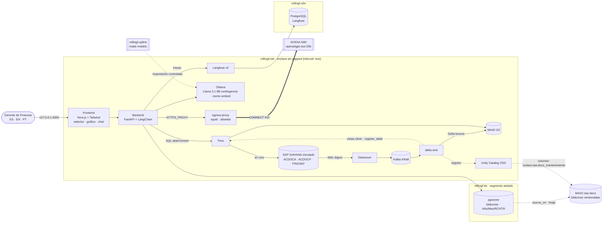

# Nodara Rolling Forecast

**Rolling Forecast de OPEX a 18 meses para la Gran Minería. Es un AI Lakehouse air-gapped en el que Trino calcula y
la IA explica.**

El Gerente de Finanzas elige un centro de costo y ve una línea de tiempo continua: los meses reales (`ACDOCA`) y,
a continuación, 18 meses de plan (`ACDOCP`, exportado desde SAP Analytics Cloud). Trino calcula de forma
determinista, sobre el lakehouse, lo siguiente:
- el OPEX en moneda de grupo (`KSL`);
- los impulsores físicos (`FINSSKF`: horas operativas y toneladas);
- el OPEX unitario (USD/h y USD/t);
- las variaciones del mes.

En el chat inferior el Gerente pregunta *"Explica la desviación de OPEX del mes actual"*. El LLM, NVIDIA NIM u
Ollama local a elección, **no calcula**: recibe las cifras de Trino y las bitácoras de mantenimiento que pgvector
filtra por **Año, Mes y RCNTR**, y explica la desviación en español, inglés o portugués. Un control determinista
verifica que cada número de la respuesta provenga de Trino.

El enclave no tiene salida a Internet. La única excepción es un gateway con allowlist hacia NVIDIA. Cada pregunta
queda trazada en Langfuse, autoalojado.

| Indicador (validado con `make smoke` y `make ui-test`) | Resultado |
|---|---|
| Servicios del stack | 14 servicios `healthy` + 2 jobs de inicialización `exit 0` |
| Modelo SAP | `ACDOCA`, `ACDOCP` y `FINSSKF` con los campos de sus fichas de tabla; ACDOCA cuadrado (Σ WSL = Σ HSL = Σ KSL = 0) |
| CDC | Debezium captura las 3 tablas (3 tópicos). Trino ve las mismas filas en S/4 en vivo, en Delta bronze y en silver |
| Cálculo determinista | USD/h de los 21 meses idéntico en Trino y en PostgreSQL. Desviación 2026-10: OPEX +12,2 %, horas −13,1 %, OPEX unitario 550,65 USD/h (+29,1 %) |
| IA explicativa (NIM `openai/gpt-oss-20b`) | 12,6–23,8 s por respuesta en ES/EN/PT; supera el objetivo de 15 s cuando el endpoint de NVIDIA está cargado ([TD-019](TECH_DEBT.md)). El 100 % de las cifras citadas está anclado a Trino (38/38, 39/39 y 49/49) |
| Contingencia local (Llama 3.1 8B en GPU) | 14,1–14,4 s; 100 % de las cifras ancladas a Trino |
| RAG con metadatos | Cada vector guarda Año/Mes/RCNTR (NOT NULL + CHECK); la recuperación filtra por el período analizado |
| Tiempo real | Un consumo de repuestos contabilizado en S/4 llega a silver y al gráfico en 6–11 s (latencia CDC 1,5–1,8 s) |
| Observabilidad | 1 traza por pregunta en Langfuse (`gerente_finanzas@nodara.com`): generación LLM + spans de Trino y pgvector |
| Air-gap y egress | Solo `integrate.api.nvidia.com` sale por el gateway; `pypi.org`, `example.com` y las APIs de FX se deniegan |

## Caso CAEX OPEX (seed estricto)

Centro de costo `RCNTR_MINA_CAEX` (Mina · Flota CAEX de camiones Komatsu). Sociedad y área de control `CL01`;
moneda funcional y de grupo USD.

| Fuente SAP | Datos sembrados |
|---|---|
| `ACDOCA` (real) | ago–oct 2026, 5 cuentas de costo. **Repuestos** (`0061100100`) al alza: USD 1,15 M → 1,29 M → 1,98 M. Oct incluye el reemplazo de emergencia de inyectores de 3 CAEX (USD 740.000, documento `4900010007`). Diésel y neumáticos bajan con las horas |
| `ACDOCP` (plan, `CATEGORY = RF18M`) | 18 meses (nov 2026 → abr 2028), una solicitud de exportación SAC. El exceso posterior al evento converge al régimen (450,47 → 413,83 USD/h; estable ±1 % desde mar 2027) |
| `FINSSKF` | Horas operativas `HOROP` 8.850 → 8.790 → **7.640 h** (caída del mes actual) y toneladas `TONMOV`; plan de horas que se recupera a 8.820 h |
| Bitácora (pgvector + raw) | `BIT-MANT-CAEX-2026-10`, Jefe de Mantenimiento, metadatos Año 2026 · Mes 10 · RCNTR `RCNTR_MINA_CAEX`: *"Parada no programada de 3 camiones Komatsu por falla prematura de inyectores debido a contaminación de diésel, reduciendo horas operativas e incrementando gasto en repuestos."* |

`sap.simulate_activity(n)` (`make simulate`) contabiliza consumos de repuestos en el período abierto; el gráfico
los refleja en vivo vía CDC.

## Modelo de datos financiero (SAP S/4HANA simulado)

| Tabla | Clave | Campos usados | Rol |
|---|---|---|---|
| `ACDOCA` Universal Journal | `RCLNT, RLDNR, RBUKRS, GJAHR, BELNR, DOCLN` | `POPER`, `FISCYEARPER`, `PERIV`, `BUDAT`, `BLART`, `RACCT`, `KOART`, `DRCRK`, `RWCUR/WSL`, `RHCUR/HSL`, **`RKCUR/KSL`**, `KOKRS`, `RCNTR`, `PRCTR`, `MATNR`, `SGTXT`, `USNAM` | Real (pasado), cuadrado por documento |
| `ACDOCP` Plan Data Line Items | `RCLNT, REQTSN, DATAPAKID, RECORD` | `RYEAR`, `RLDNR`, `RBUKRS`, **`CATEGORY`**, `RACCT`, `RWCUR/WSL`, `RHCUR/HSL`, `RKCUR/KSL`, `KOKRS`, `RCNTR`, `PRCTR`, `PERIV`, `POPER`, `FISCYEARPER`, `BUDAT`, `SGTXT`, `USNAM` | Plan / forecast (futuro) |
| `FINSSKF` GL statistical key figures | `RCLNT, STAGR, RECID, DATE_FROM` | `GRTYP`, `MSL`, `RUNIT`, `TIMESTAMP`, `RBUKRS`, `RRCTY`, `CATEGORY`, `RCNTR`, `PRCTR`, `KOKRS`, `LOGSYS` | Impulsores físicos reales (`RRCTY 0`) y de plan (`RRCTY 1`) |

> **Versión del plan.** Las fichas de `ACDOCP` y `FINSSKF` entregadas por el Arquitecto no tienen `RVERS`: en S/4HANA
> la versión de un plan exportado desde SAC es la *plan category* (`CATEGORY`). El rolling forecast usa
> `CATEGORY = RF18M`; otro ciclo o un presupuesto serían otra categoría.

## Arquitectura



| Capa | Componente | Versión | Host (127.0.0.1) |
|---|---|---|---|
| Transaccional | SAP S/4HANA simulado: PostgreSQL relacional, esquema `sap` (3 tablas financieras) | postgres 16.15 | `S4_DB_PORT` |
| CDC | Debezium Connect (pgoutput) + Kafka KRaft | 3.6.3 / 4.3.2 | Debezium REST 8083 |
| Lakehouse | MinIO (`lakehouse` + `raw-docs`) + Delta Lake (bronze + vistas silver) + Unity Catalog OSS + Trino | 2026-08 / delta-rs 1.6 / 0.7.0 / 484 | MinIO 9000/9001 · UC 8081 · Trino 8080 |
| Conocimiento | PostgreSQL + pgvector aislado (solo bitácoras, metadatos Año/Mes/RCNTR) | pgvector 0.8.7 | 5433 |
| IA y backend | FastAPI + LangChain 0.3 → NVIDIA NIM (`openai/gpt-oss-20b`) con contingencia Ollama (Llama 3.1 8B); embeddings locales | Ollama 0.40.11 | no publicado |
| Salida controlada | Gateway squid: default deny, solo CONNECT 443 a `integrate.api.nvidia.com` | squid 6.6 | no publicado |
| Observabilidad GenAI | Langfuse v2 autoalojado (SDK v2 + `CallbackHandler`) | 2.95.11 / SDK 2.60.10 | 3001 |
| Frontend | Next.js + TailwindCSS (ES/EN/PT, selector de centro de costo, KPIs, gráfico SVG real + plan, chat IA, selector de motor) | Next 16.4 · Tailwind 4.3 | 3000 |

### Cálculo determinista (Trino) y control de cifras

- **Silver.** `delta-sink` crea por tabla una vista `lakehouse.silver.<tabla>` con el estado vigente: última imagen
  CDC por clave primaria (tomada de la key de Debezium) y sin registros borrados. El backend nunca lee bronze para
  calcular.
- **SQL de negocio** (`backend/app/lakehouse.py`): OPEX mensual por cuenta (`KSL`) de los meses reales y, después del
  último real, el plan de la categoría. Además: impulsores `FINSSKF` (totales del mes, `GRTYP 2`), OPEX unitario,
  variación del mes analizado vs. mes anterior y vs. línea base (promedio de los meses reales previos), mayores
  partidas y horizonte del plan (primer y último mes, total y punto de estabilización ±1 %).
- **Python y la UI solo formatean.** Las cifras llegan al LLM ya calculadas, en el formato numérico del idioma de
  respuesta.
- **Control de cifras** (`backend/app/figures.py`): extrae cada número de la respuesta y lo contrasta con el contexto
  (Trino, bitácoras y pregunta). Admite ambos formatos (`4.207.000` / `4,207,000` / `4 207 000`), redondeos y escalas
  (`4,21 M`, millones, milhões, mil, k). Los números no anclados se informan en la UI y en Langfuse.

### Flujo de una pregunta

1. La UI envía `{"question", "language": "ES|EN|PT", "engine": "nim|ollama", "rcntr"}`. `period` (`YYYY-MM`) es
   opcional; por defecto se usa el último mes real.
2. Se abre una traza de Langfuse con `user_id` = `TRACE_USER_ID` y Trino calcula la desviación y el horizonte del plan
   (span *trino · OPEX unitario*).
3. `nomic-embed-text` (local) vectoriza la pregunta. pgvector filtra por `rcntr`, `gjahr` y `monat` del período y
   ordena por similitud (span *retrieval*).
4. El LLM redacta con un *system prompt* por idioma que le prohíbe calcular. Formato: desviación, causa operacional
   (bitácora citada `[DOC-ID §sección]`), impacto en el forecast y fuentes.
5. Controles deterministas: **idioma** (re-traducción si se desvió) y **cifras** (`figures_check`).
6. La respuesta trae el análisis de Trino, las bitácoras con sus metadatos, el filtro aplicado, el motor y el modelo,
   los intentos, la traza de Langfuse y los tiempos por etapa.

### Pipeline en tiempo real

`S/4 (WAL) → Debezium → Kafka (s4hana.sap.*) → delta-sink → s3://lakehouse/bronze/<tabla>` (Delta append-only con
`_cdc_op`, `_source_ts`, `_source_lsn` e `_ingested_at`) → vista silver → Trino → API → gráfico. El gráfico se
refresca cada 20 s. Para generar actividad: `make simulate n=10`.

### Raw layer (gobierno de datos)

- **Fuente única**: los originales (`knowledge/raw-docs/<origen>/*.md`), con front matter obligatorio `gjahr`,
  `monat` y `rcntr`. `make kb-seed` genera el seed de pgvector y falla si falta un metadato.
- **MinIO `raw-docs`**: el bucket está versionado; un archivo solo se sube si cambió su SHA-256. Cada objeto lleva los
  metadatos `Sha256`, `Classification`, `Language`, `Rcntr`, `Gjahr` y `Monat`.
- **Catálogo y linaje**: volumen EXTERNAL `nodara.raw.docs_<origen>` en Unity Catalog. `kb.documents.source_uri` apunta
  al original y `make smoke` verifica índice ⊆ raw.

## Air-gap: diseño de redes

| Red | Tipo | Quién | Propósito |
|---|---|---|---|
| `rollingf-net` | `internal: true` | todo el stack | plano de datos e IA; sin egress |
| `rollingf-kb` | `internal: true` | backend + vector-db | base de conocimiento aislada |
| `rollingf-obs` | `internal: true` | langfuse + langfuse-db | base de datos de trazas aislada |
| `rollingf-egress` | bridge | solo `egress-proxy` | única salida a Internet en runtime (allowlist: NVIDIA) |
| `rollingf-edge` | bridge | solo servicios con puerto publicado | acceso del operador (bind 127.0.0.1) |
| `rollingf-uplink` | bridge | `ollama-bootstrap` (perfil) | única vía de entrada de modelos (`make models`) |

Ollama, el backend, Kafka y delta-sink nunca tocan `rollingf-edge` ni tienen salida directa. El backend sale solo por
`egress-proxy` hacia NVIDIA. Las APIs de tipo de cambio del proyecto anterior se quitaron de la allowlist: el OPEX
está en USD y no hay conversión.

## Puesta en marcha

Requisitos: Docker Engine/Desktop con Compose v2, `make`, `curl` y `python3`. Recursos recomendados: 8 vCPU y 16 GB de
RAM. Este proyecto usa los mismos puertos que `nodara-br-rag`: si ese stack está corriendo, deténlo antes
(`docker compose stop` en su carpeta).

```bash
make env         # crea .env con secretos aleatorios y claves de Langfuse; NVIDIA_API_KEY se completa a mano (opcional)
make preflight   # detecta colisiones de puertos (Linux/WSL + Windows)
make up          # build + up del stack completo; espera a que todo esté healthy
make models      # importa Llama 3.1 + nomic-embed-text vía uplink (~5 GB)
                 #   o sin Internet: make models from=nodara-br-rag_ollama-models (copia offline desde otro volumen)
make embed       # vectoriza las bitácoras en pgvector
make smoke       # re-siembra (make fresh) y corre la QA E2E completa
make ui-test     # QA de UI (Playwright): idioma, centro de costo, gráfico real + plan, chat y motor
make demo        # re-siembra para una demo: caso CAEX en su estado inicial
make simulate n=10  # contabiliza consumos de repuestos y los ves llegar al gráfico
```

Consola: <http://localhost:3000> · Langfuse: <http://localhost:3001> (usuario `LANGFUSE_ADMIN_EMAIL`, contraseña
`LANGFUSE_ADMIN_PASSWORD` de `.env`) · Trino UI: <http://localhost:8080> · MinIO: <http://localhost:9001> ·
Unity Catalog: <http://localhost:8081/api/2.1/unity-catalog/catalogs> · Debezium: <http://localhost:8083/connectors>

Consultas útiles en Trino (`docker compose exec trino trino`):
`SELECT * FROM lakehouse.silver.acdocp WHERE category = 'RF18M'` ·
`SELECT * FROM lakehouse.silver.finsskf ORDER BY date_from` · `SELECT count(*) FROM lakehouse.bronze.acdoca`.

## API (backend, vía el proxy del frontend `/api/*`)

| Método | Ruta | Descripción |
|---|---|---|
| GET | `/api/opex/cost-centers` | Centros de costo con meses reales y categorías de plan |
| GET | `/api/opex/timeline?rcntr=RCNTR_MINA_CAEX[&category=RF18M]` | Serie mensual real + plan (OPEX por cuenta, horas, toneladas, USD/h, USD/t) y resumen de desviación |
| POST | `/api/ask` | `{question, language, engine, rcntr, period?}` → respuesta, análisis de Trino, bitácoras, controles, traza |
| POST | `/api/kb/embed` | Vectoriza los fragmentos pendientes (`make embed`) |
| GET | `/api/status` | S/4 en vivo, CDC, base de conocimiento, motores de IA y Langfuse |

## Decisiones de arquitectura

| Decisión | Motivo |
|---|---|
| Las tres tablas siguen las fichas SAP entregadas (`ACDOCP` con `CATEGORY` y clave `REQTSN/DATAPAKID/RECORD`; `FINSSKF` con `STAGR/RECID/DATE_FROM`) | Sin columnas inventadas: el modelo se puede contrastar con un S/4HANA real. `RVERS` no existe en ACDOCP. |
| Trino calcula todo; el LLM solo explica, y un control de cifras lo verifica | La aritmética es el punto débil de los LLM. Las cifras se pueden auditar contra Trino y contra PostgreSQL (`make smoke`). |
| Silver como vistas Trino generadas por `delta-sink` (PK de la key Debezium) | Estado vigente sin duplicados *at-least-once* y sin código por tabla. |
| Desviación vs. mes anterior y vs. línea base de meses reales | ACDOCP solo contiene el futuro (especificación): no hay plan del mes en curso con qué comparar (TD-006). |
| Recuperación filtrada por Año/Mes/RCNTR antes de la similitud | La IA solo lee las bitácoras del centro de costo y del mes que explica. |
| Forma de énfasis en el gráfico (la cuenta que impulsa la desviación en acento, el resto en gris), un eje por medida | El relato es "una cuenta subió". Nunca doble eje; tabla equivalente y tooltip accesible por teclado. |
| Gráfico SVG propio | Stack cerrado: sin dependencias nuevas en el frontend. |
| Sociedad y grupo en USD | Moneda funcional típica de la gran minería del cobre: WSL = HSL = KSL, sin tasas ni APIs de FX (se quitaron del egress). |
| Proyecto compose, contenedores, redes e imágenes propios (`rollingf-*`) | Convive con `nodara-br-rag` sin pisar sus contenedores, imágenes ni volúmenes (`reset-data` solo borra `nodara-rollingf_*`). |
| NIM `openai/gpt-oss-20b` por defecto, Ollama como contingencia | Llama 3.1/3.3 70B responden 410 (EOL) en NVIDIA. Ollama conserva el modo estrictamente air-gapped. |
| Langfuse v2 + LangChain 0.3 LTS · idioma en cookie + render en servidor | Heredados y validados del stack anterior. |

## Estructura

```
├── docker-compose.yml          # stack completo (proyecto nodara-rollingf, redes rollingf-*, egress, healthchecks)
├── TECH_DEBT.md                # registro de deuda técnica de este proyecto
├── egress/                     # squid.conf + allowlist.txt (solo NVIDIA)
├── knowledge/raw-docs/         # bitácoras originales (front matter con gjahr, monat y rcntr obligatorios)
├── init-scripts/
│   ├── s4hana/                 # roles, ACDOCA/ACDOCP/FINSSKF, seed del caso CAEX, simulador y contrato CDC
│   └── vectordb/               # pgvector: esquema con metadatos obligatorios + seed GENERADO (make kb-seed)
├── cdc/                        # conector Debezium (3 tablas) + registro idempotente
├── lakehouse/
│   ├── minio/                  # buckets lakehouse + raw-docs, service account, volúmenes UC
│   ├── trino/catalog/          # catálogos lakehouse (Delta) y s4hana (PostgreSQL)
│   └── delta-sink/             # Kafka CDC → Delta bronze + vistas silver + registro Trino/UC
├── backend/app/                # lakehouse.py (SQL Trino), opex.py, orchestrator.py, figures.py, knowledge.py, llm.py…
├── frontend/                   # consola Next.js (selector, KPIs, gráfico, chat; ES/EN/PT) + e2e Playwright
└── scripts/                    # init-env, preflight, wait-healthy, build-kb-seed, smoke-test
```

## Roadmap

La deuda técnica priorizada vive en [TECH_DEBT.md](TECH_DEBT.md).

1. Varianza real vs. plan: presupuesto o ciclo previo como categoría de `ACDOCP` y su cálculo en Trino (TD-006).
2. Datos maestros SAP (SKAT, CSKT, TKA03) en lugar de los textos del backend (TD-001, TD-002).
3. Silver materializado con `MERGE` y una capa gold de KPIs de OPEX (TD-004).
4. Respuestas con referencias a cifras resueltas por el backend, para que el texto no pueda alterar un número (TD-007).
5. Seguridad de plataforma (autenticación y TLS en Trino, UC y Kafka) y migración a Langfuse ≥ 3 + LangChain 1.x.
