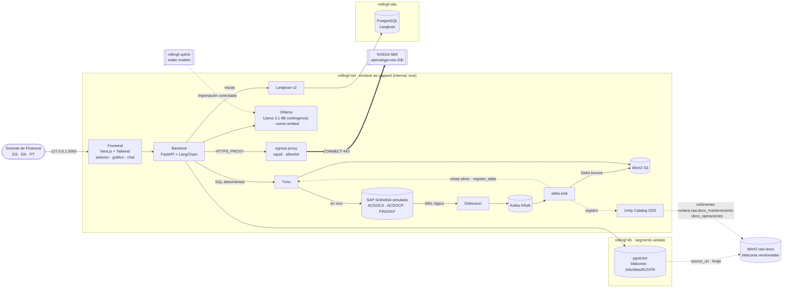

# Nodara Rolling Forecast

**Rolling Forecast de OPEX a 18 meses para la cadena de valor de la Gran Minería. Es un AI Lakehouse air-gapped en
el que Trino calcula y la IA explica.**

El Gerente de Finanzas elige uno de los 5 centros de costo del OPEX C1 (mina, lixiviación, concentradora y puerto) y
ve una línea de tiempo continua con tres partes:
- los meses reales (`ACDOCA`);
- el presupuesto base de esos mismos meses (`ACDOCP · CATEGORY = BUDG`);
- a continuación, 18 meses de plan (`ACDOCP · CATEGORY = RF18M`, exportado desde SAP Analytics Cloud).

Trino calcula de forma determinista, sobre el lakehouse, lo siguiente:
- el OPEX en moneda de grupo (`KSL`) por cuenta;
- los impulsores físicos (`FINSSKF`): horas operativas o toneladas movidas, apiladas, procesadas o embarcadas;
- el OPEX unitario de cada impulsor (USD/h, USD/t, USD/WMT);
- la **desviación del mes = real − presupuesto (`BUDG`)**, con el mes anterior como contexto.

En el chat inferior el Gerente pregunta, por ejemplo, *"Explica la desviación de OPEX del mes actual"* o *"¿Por qué
subió el OPEX unitario del puerto este mes?"*. El LLM, NVIDIA NIM u Ollama local a elección, **no calcula**: recibe
las cifras de Trino y las bitácoras operacionales que pgvector filtra por **Año, Mes y RCNTR**. Con eso explica la
desviación en español, inglés o portugués, y distingue si el OPEX unitario se mueve por el gasto o por el impulsor
físico. Un control determinista verifica que cada número de la respuesta provenga de Trino.

El enclave no tiene salida a Internet. La única excepción es un gateway con allowlist hacia NVIDIA. Cada pregunta
queda trazada en Langfuse, autoalojado.

| Indicador (validado con `make smoke` y `make ui-test`) | Resultado |
|---|---|
| Servicios del stack | 14 servicios `healthy` + 2 jobs de inicialización `exit 0` |
| Modelo SAP | `ACDOCA`, `ACDOCP` y `FINSSKF` con los campos de sus fichas de tabla; categorías de plan `BUDG` + `RF18M`; ACDOCA cuadrado (Σ WSL = Σ HSL = Σ KSL = 0) |
| CDC | Debezium captura las 3 tablas (3 tópicos). Trino ve las mismas filas en S/4 en vivo, en Delta bronze y en silver (152 / 504 / 144) |
| Cálculo determinista | Para los 5 centros de costo, el OPEX unitario de los 21 meses y la desviación vs. `BUDG` son idénticos en Trino y en PostgreSQL |
| IA explicativa (NIM `openai/gpt-oss-20b`) | 10,6–15,1 s por respuesta (ES/EN/PT y la pregunta del puerto); EN superó por 0,1 s el objetivo de 15 s ([TD-019](TECH_DEBT.md)). El 100 % de las cifras citadas está anclado a Trino (46/46, 46/46, 27/27 y 25/25) y la causa se cita desde la bitácora filtrada (inyectores, marejadas) |
| Contingencia local (Llama 3.1 8B en GPU) | 15,6 s; 100 % de las cifras ancladas a Trino (17/17) |
| RAG con metadatos | 5 bitácoras, una por centro de costo. Cada vector guarda Año/Mes/RCNTR (NOT NULL + CHECK); el filtro devuelve exactamente la bitácora del centro y del mes analizados |
| Tiempo real | Un consumo de repuestos contabilizado en S/4 llega a silver y al gráfico en 9–12 s. La latencia CDC fue de 4,7–5,7 s: el `delta-sink` confirma en Delta cada 5 s, así que varía entre ~1 y ~6 s según el momento en que llega el evento |
| Observabilidad | 1 traza por pregunta en Langfuse (`gerente_finanzas@nodara.com`): generación LLM + spans de Trino y pgvector |
| Air-gap y egress | Solo `integrate.api.nvidia.com` sale por el gateway; `pypi.org`, `example.com` y las APIs de FX se deniegan |

## Cadena de valor del OPEX C1 (seed estricto: 5 casos aprobados)

Sociedad y área de control `CL01`; moneda funcional y de grupo USD. El mes actual es 2026-10, el último mes real.

| Centro de costo | Impulsor del OPEX unitario | Evento de 2026-10 (bitácora) | 2026-10 vs. `BUDG` (Trino) |
|---|---|---|---|
| `RCNTR_MINA_CAEX` · Mina · Flota CAEX | `HOROP` horas operativas (h) | Parada no programada de 3 camiones Komatsu por inyectores dañados por diésel contaminado (`BIT-MANT-CAEX-2026-10`) | Repuestos +67,8 %; OPEX +15,3 %; horas −13,4 %; 550,65 vs. 413,83 USD/h (+33,1 %) |
| `RCNTR_MINA_TRUCK` · Mina · Extracción | `TONMOV` toneladas movidas (t) | Inundación estacional del fondo del rajo: extracción −15 % y motobombas de achique (`BIT-OPER-MINA-2026-10`) | Combustible +16,7 %; OPEX +7,0 %; toneladas −15,0 %; 1,0975 vs. 0,8717 USD/t (+25,9 %) |
| `RCNTR_LIXIV_SXEW` · Planta de Lixiviación SX-EW | `TONAPI` toneladas apiladas (t) | Falla catastrófica de la bomba principal de ácido sulfúrico: riego detenido 48 h (`BIT-MANT-SXEW-2026-10`) | Repuestos +141,9 %; OPEX +11,2 %; toneladas −14,0 %; 3,8450 vs. 2,9733 USD/t (+29,3 %) |
| `RCNTR_CONCEN_FLOT` · Planta Concentradora · Flotación | `TONPRO` toneladas procesadas (t) | Caída abrupta de ley: colector xantato a 15 g/t (`BIT-OPER-FLOT-2026-10`) | Reactivos +42,4 %; OPEX +5,9 %; toneladas −0,9 %; 3,1550 vs. 2,9516 USD/t (+6,9 %) |
| `RCNTR_PUERTO_EMB` · Puerto · Embarque | `TONEMB` toneladas embarcadas (WMT) | Marejadas: 5 días sin atraque de buques (`BIT-OPER-PUERTO-2026-10`) | Costos fijos en presupuesto (OPEX −0,3 %; almacenamiento = `BUDG`); toneladas −18,5 %; 5,0094 vs. 4,0962 USD/WMT (+22,3 %) |

Por centro de costo:

| Fuente SAP | Datos sembrados |
|---|---|
| `ACDOCA` (real) | ago–oct 2026, documentos cuadrados. Cada evento de octubre es un documento propio, por ejemplo `4900010023` «Reemplazo inyectores 3 CAEX Komatsu (emergencia)» por USD 740.000 |
| `ACDOCP · BUDG` | Presupuesto base 2026 para ago–oct (una solicitud de exportación SAC del 2025-12-15), niveles mensuales planos |
| `ACDOCP · RF18M` | 18 meses (nov 2026 → abr 2028, exportación SAC del 2026-10-28) que convergen a los niveles del presupuesto. CAEX: 450,47 → 413,83 USD/h, estable ±1 % desde mar 2027 |
| `FINSSKF` | Impulsores reales (`RRCTY 0`, sistemas de origen `DISPATCH`, `PIMS` y `PORTMS`) y de plan (`RRCTY 1`, `CATEGORY` `BUDG` y `RF18M`, origen `SAC`) |
| Bitácoras (pgvector + raw) | Una por centro de costo, con metadatos Año 2026 · Mes 10 · RCNTR y el texto exacto aprobado por el Arquitecto. Orígenes `mantenimiento` (CAEX, SX-EW) y `operaciones` (mina, concentradora, puerto) |

`sap.simulate_activity(n)` (`make simulate`) contabiliza consumos de repuestos de la flota CAEX en el período
abierto; el gráfico los refleja en vivo vía CDC.

## Modelo de datos financiero (SAP S/4HANA simulado)

| Tabla | Clave | Campos usados | Rol |
|---|---|---|---|
| `ACDOCA` Universal Journal | `RCLNT, RLDNR, RBUKRS, GJAHR, BELNR, DOCLN` | `POPER`, `FISCYEARPER`, `PERIV`, `BUDAT`, `BLART`, `RACCT`, `KOART`, `DRCRK`, `RWCUR/WSL`, `RHCUR/HSL`, **`RKCUR/KSL`**, `KOKRS`, `RCNTR`, `PRCTR`, `MATNR`, `SGTXT`, `USNAM` | Real (pasado), cuadrado por documento |
| `ACDOCP` Plan Data Line Items | `RCLNT, REQTSN, DATAPAKID, RECORD` | `RYEAR`, `RLDNR`, `RBUKRS`, **`CATEGORY`**, `RACCT`, `RWCUR/WSL`, `RHCUR/HSL`, `RKCUR/KSL`, `KOKRS`, `RCNTR`, `PRCTR`, `PERIV`, `POPER`, `FISCYEARPER`, `BUDAT`, `SGTXT`, `USNAM` | Presupuesto base (`BUDG`, meses reales) y forecast (`RF18M`, futuro) |
| `FINSSKF` GL statistical key figures | `RCLNT, STAGR, RECID, DATE_FROM` | `GRTYP`, `MSL`, `RUNIT` (`H`, `TO`, `WMT`), `TIMESTAMP`, `RBUKRS`, `RRCTY`, `CATEGORY`, `RCNTR`, `PRCTR`, `KOKRS`, `LOGSYS` | Impulsores físicos reales (`RRCTY 0`) y de plan (`RRCTY 1` + `CATEGORY`); `RECID` = un ítem por centro de costo e impulsor |

> **Versión del plan.** Las fichas de `ACDOCP` y `FINSSKF` entregadas por el Arquitecto no tienen `RVERS`: en S/4HANA
> la versión de un plan exportado desde SAC es la *plan category* (`CATEGORY`). El presupuesto base usa
> `CATEGORY = BUDG` y el rolling forecast `CATEGORY = RF18M`; otro ciclo sería otra categoría.

## Arquitectura



| Capa | Componente | Versión | Host (127.0.0.1) |
|---|---|---|---|
| Transaccional | SAP S/4HANA simulado: PostgreSQL relacional, esquema `sap` (3 tablas financieras) | postgres 16.15 | `S4_DB_PORT` |
| CDC | Debezium Connect (pgoutput) + Kafka KRaft | 3.6.3 / 4.3.2 | Debezium REST 8083 |
| Lakehouse | MinIO (`lakehouse` + `raw-docs`) + Delta Lake (bronze + vistas silver) + Unity Catalog OSS + Trino | 2026-08 / delta-rs 1.6 / 0.7.0 / 484 | MinIO 9000/9001 · UC 8081 · Trino 8080 |
| Conocimiento | PostgreSQL + pgvector aislado (solo bitácoras, metadatos Año/Mes/RCNTR) | pgvector 0.8.7 | 5433 |
| IA y backend | FastAPI + LangChain 0.3 → NVIDIA NIM (`openai/gpt-oss-20b`) con contingencia Ollama (Llama 3.1 8B); embeddings locales | Ollama 0.40.11 | no publicado |
| Salida controlada | Gateway squid: default deny, solo CONNECT 443 a `integrate.api.nvidia.com` | squid 6.6 | no publicado |
| Observabilidad GenAI | Langfuse v2 autoalojado (SDK v2 + `CallbackHandler`) | 2.95.11 / SDK 2.60.10 | 3001 |
| Frontend | Next.js + TailwindCSS (ES/EN/PT, selector de centro de costo, KPIs vs. presupuesto, gráfico SVG real + presupuesto + plan, chat IA, selector de motor) | Next 16.4 · Tailwind 4.3 | 3000 |

### Cálculo determinista (Trino) y control de cifras

- **Silver.** `delta-sink` crea por tabla una vista `lakehouse.silver.<tabla>` con el estado vigente: última imagen
  CDC por clave primaria (tomada de la key de Debezium) y sin registros borrados. El backend nunca lee bronze para
  calcular.
- **SQL de negocio** (`backend/app/lakehouse.py`): OPEX mensual por cuenta (`KSL`) de los meses reales, con el
  presupuesto `BUDG` del mismo mes al lado, y después del último real el plan de la categoría (`RF18M`). Además:
  - impulsores `FINSSKF` (totales del mes, `GRTYP 2`) y el OPEX unitario de cada impulsor;
  - **desviación del mes analizado = real − `BUDG`** por cuenta, por impulsor y por OPEX unitario, con la variación
    vs. el mes anterior como contexto;
  - mayores partidas;
  - horizonte del plan sobre el impulsor del centro de costo: primer y último mes, total y punto de estabilización ±1 %.
- **Python y la UI solo formatean.** Las cifras llegan al LLM ya calculadas, en el formato numérico del idioma de
  respuesta.
- **Control de cifras** (`backend/app/figures.py`): extrae cada número de la respuesta y lo contrasta con el contexto
  (Trino, bitácoras y pregunta). Admite ambos formatos (`4.207.000` / `4,207,000` / `4 207 000`), redondeos y escalas
  (`4,21 M`, millones, milhões, mil, k). Los números no anclados se informan en la UI y en Langfuse.

### Flujo de una pregunta

1. La UI envía `{"question", "language": "ES|EN|PT", "engine": "nim|ollama", "rcntr"}`. `period` (`YYYY-MM`) es
   opcional; por defecto se usa el último mes real.
2. Se abre una traza de Langfuse con `user_id` = `TRACE_USER_ID` y Trino calcula la desviación y el horizonte del plan
   (span *trino · OPEX unitario*).
3. `nomic-embed-text` (local) vectoriza la pregunta. pgvector filtra por `rcntr`, `gjahr` y `monat` del período y
   ordena por similitud (span *retrieval*).
4. El LLM redacta con un *system prompt* por idioma que le prohíbe calcular. Formato: desviación frente al
   presupuesto, causa operacional (bitácora citada `[DOC-ID §sección]`, distinguiendo gasto e impulsor físico),
   impacto en el forecast y fuentes.
5. Controles deterministas: **idioma** (re-traducción si se desvió) y **cifras** (`figures_check`).
6. La respuesta trae el análisis de Trino, las bitácoras con sus metadatos, el filtro aplicado, el motor y el modelo,
   los intentos, la traza de Langfuse y los tiempos por etapa.

### Pipeline en tiempo real

`S/4 (WAL) → Debezium → Kafka (s4hana.sap.*) → delta-sink → s3://lakehouse/bronze/<tabla>` (Delta append-only con
`_cdc_op`, `_source_ts`, `_source_lsn` e `_ingested_at`) → vista silver → Trino → API → gráfico. El gráfico se
refresca cada 20 s. Para generar actividad: `make simulate n=10`.

### Raw layer (gobierno de datos)

- **Fuente única**: los originales (`knowledge/raw-docs/<origen>/*.md`, orígenes `mantenimiento` y `operaciones`),
  con front matter obligatorio `gjahr`, `monat` y `rcntr`. `make kb-seed` genera el seed de pgvector y falla si falta un metadato.
- **MinIO `raw-docs`**: el bucket está versionado; un archivo solo se sube si cambió su SHA-256. Cada objeto lleva los
  metadatos `Sha256`, `Classification`, `Language`, `Rcntr`, `Gjahr` y `Monat`.
- **Catálogo y linaje**: volumen EXTERNAL `nodara.raw.docs_<origen>` en Unity Catalog. `kb.documents.source_uri` apunta
  al original y `make smoke` verifica índice ⊆ raw.

## Air-gap: diseño de redes

| Red | Tipo | Quién | Propósito |
|---|---|---|---|
| `rollingf-net` | `internal: true` | todo el stack | plano de datos e IA; sin egress |
| `rollingf-kb` | `internal: true` | backend + vector-db | base de conocimiento aislada |
| `rollingf-obs` | `internal: true` | langfuse + langfuse-db | base de datos de trazas aislada |
| `rollingf-egress` | bridge | solo `egress-proxy` | única salida a Internet en runtime (allowlist: NVIDIA) |
| `rollingf-edge` | bridge | solo servicios con puerto publicado | acceso del operador (bind 127.0.0.1) |
| `rollingf-uplink` | bridge | `ollama-bootstrap` (perfil) | única vía de entrada de modelos (`make models`) |

Ollama, el backend, Kafka y delta-sink nunca tocan `rollingf-edge` ni tienen salida directa. El backend sale solo por
`egress-proxy` hacia NVIDIA. Las APIs de tipo de cambio del proyecto anterior se quitaron de la allowlist: el OPEX
está en USD y no hay conversión.

## Puesta en marcha

Requisitos: Docker Engine/Desktop con Compose v2, `make`, `curl` y `python3`. Recursos recomendados: 8 vCPU y 16 GB de
RAM. Este proyecto usa los mismos puertos que `nodara-br-rag`: si ese stack está corriendo, deténlo antes
(`docker compose stop` en su carpeta).

```bash
make env         # crea .env con secretos aleatorios y claves de Langfuse; NVIDIA_API_KEY se completa a mano (opcional)
make preflight   # detecta colisiones de puertos (Linux/WSL + Windows)
make up          # build + up del stack completo; espera a que todo esté healthy
make models      # importa Llama 3.1 + nomic-embed-text vía uplink (~5 GB)
                 #   o sin Internet: make models from=nodara-br-rag_ollama-models (copia offline desde otro volumen)
make embed       # vectoriza las bitácoras en pgvector
make smoke       # re-siembra (make fresh) y corre la QA E2E completa
make ui-test     # QA de UI (Playwright): idioma, 5 centros de costo, gráfico real + presupuesto + plan, chat y motor
make demo        # re-siembra para una demo: los 5 casos en su estado inicial
make simulate n=10  # contabiliza consumos de repuestos y los ves llegar al gráfico
```

Consola: <http://localhost:3000> · Langfuse: <http://localhost:3001> (usuario `LANGFUSE_ADMIN_EMAIL`, contraseña
`LANGFUSE_ADMIN_PASSWORD` de `.env`) · Trino UI: <http://localhost:8080> · MinIO: <http://localhost:9001> ·
Unity Catalog: <http://localhost:8081/api/2.1/unity-catalog/catalogs> · Debezium: <http://localhost:8083/connectors>

Consultas útiles en Trino (`docker compose exec trino trino`):
`SELECT * FROM lakehouse.silver.acdocp WHERE category IN ('BUDG', 'RF18M')` ·
`SELECT * FROM lakehouse.silver.finsskf ORDER BY date_from` · `SELECT count(*) FROM lakehouse.bronze.acdoca`.

## API (backend, vía el proxy del frontend `/api/*`)

| Método | Ruta | Descripción |
|---|---|---|
| GET | `/api/opex/cost-centers` | Centros de costo en orden de la cadena de valor, con meses reales, categorías de plan y presupuesto |
| GET | `/api/opex/timeline?rcntr=RCNTR_PUERTO_EMB[&category=RF18M]` | Serie mensual real (con su `BUDG`) + plan: OPEX por cuenta, impulsores y OPEX unitario por impulsor, y resumen de desviación real − `BUDG` |
| POST | `/api/ask` | `{question, language, engine, rcntr, period?}` → respuesta, análisis de Trino, bitácoras, controles, traza |
| POST | `/api/kb/embed` | Vectoriza los fragmentos pendientes (`make embed`) |
| GET | `/api/status` | S/4 en vivo, CDC, base de conocimiento, motores de IA y Langfuse |

## Decisiones de arquitectura

| Decisión | Motivo |
|---|---|
| Las tres tablas siguen las fichas SAP entregadas (`ACDOCP` con `CATEGORY` y clave `REQTSN/DATAPAKID/RECORD`; `FINSSKF` con `STAGR/RECID/DATE_FROM`) | Sin columnas inventadas: el modelo se puede contrastar con un S/4HANA real. `RVERS` no existe en ACDOCP. |
| Trino calcula todo; el LLM solo explica, y un control de cifras lo verifica | La aritmética es el punto débil de los LLM. Las cifras se pueden auditar contra Trino y contra PostgreSQL (`make smoke`). |
| Silver como vistas Trino generadas por `delta-sink` (PK de la key Debezium) | Estado vigente sin duplicados *at-least-once* y sin código por tabla. |
| Desviación = real − presupuesto (`ACDOCP`/`FINSSKF` con `CATEGORY = BUDG`); el mes anterior queda como contexto | Instrucción del Arquitecto (iteración 2, cierra TD-006): la referencia de control de gestión es el presupuesto base. |
| Impulsor del OPEX unitario por centro de costo (`UNIT_DRIVERS` en `masterdata.py`) | Cada etapa tiene su unidad física: horas de flota, toneladas movidas, apiladas, procesadas o WMT embarcadas. |
| Recuperación filtrada por Año/Mes/RCNTR antes de la similitud | La IA solo lee las bitácoras del centro de costo y del mes que explica. |
| Forma de énfasis en el gráfico (la cuenta con el mayor sobrecosto material vs. `BUDG` en acento, el resto en gris), presupuesto como tick de referencia, un eje por medida | El relato es "una cuenta subió". En el puerto ninguna cuenta se desvía, así que no hay acento y el relato está en la medida USD/WMT. Nunca doble eje; tabla equivalente y tooltip accesible por teclado. |
| Gráfico SVG propio | Stack cerrado: sin dependencias nuevas en el frontend. |
| Sociedad y grupo en USD | Moneda funcional típica de la gran minería del cobre: WSL = HSL = KSL, sin tasas ni APIs de FX (se quitaron del egress). |
| Proyecto compose, contenedores, redes e imágenes propios (`rollingf-*`) | Convive con `nodara-br-rag` sin pisar sus contenedores, imágenes ni volúmenes (`reset-data` solo borra `nodara-rollingf_*`). |
| NIM `openai/gpt-oss-20b` por defecto, Ollama como contingencia | Iteración 2: `meta-llama/llama-3.3-70b-instruct` no es un ID de NVIDIA (404) y `meta/llama-3.3-70b-instruct` está retirado desde el 2026-08-26 (410). Ningún Llama de 70B está habilitado para la cuenta (TD-010). Ollama conserva el modo estrictamente air-gapped. |
| Langfuse v2 + LangChain 0.3 LTS · idioma en cookie + render en servidor | Heredados y validados del stack anterior. |

## Estructura

```
├── docker-compose.yml          # stack completo (proyecto nodara-rollingf, redes rollingf-*, egress, healthchecks)
├── TECH_DEBT.md                # registro de deuda técnica de este proyecto
├── egress/                     # squid.conf + allowlist.txt (solo NVIDIA)
├── knowledge/raw-docs/         # bitácoras originales por origen (mantenimiento, operaciones); gjahr, monat y rcntr obligatorios
├── init-scripts/
│   ├── s4hana/                 # roles, ACDOCA/ACDOCP/FINSSKF, seed de la cadena de valor (5 casos), simulador y CDC
│   └── vectordb/               # pgvector: esquema con metadatos obligatorios + seed GENERADO (make kb-seed)
├── cdc/                        # conector Debezium (3 tablas) + registro idempotente
├── lakehouse/
│   ├── minio/                  # buckets lakehouse + raw-docs, service account, volúmenes UC
│   ├── trino/catalog/          # catálogos lakehouse (Delta) y s4hana (PostgreSQL)
│   └── delta-sink/             # Kafka CDC → Delta bronze + vistas silver + registro Trino/UC
├── backend/app/                # lakehouse.py (SQL Trino), opex.py, orchestrator.py, figures.py, knowledge.py, llm.py…
├── frontend/                   # consola Next.js (selector, KPIs, gráfico, chat; ES/EN/PT) + e2e Playwright
└── scripts/                    # init-env, preflight, wait-healthy, build-kb-seed, smoke-test
```

## Roadmap

La deuda técnica priorizada vive en [TECH_DEBT.md](TECH_DEBT.md).

1. Presupuesto anual completo (FY 2026–2028) y forecast vs. presupuesto en Trino (TD-020).
2. Datos maestros SAP (SKAT, CSKT, TKA03) e impulsor del OPEX unitario en los datos maestros, en lugar del backend
   (TD-001, TD-002).
3. Silver materializado con `MERGE` y una capa gold de KPIs de OPEX (TD-004).
4. Respuestas con referencias a cifras resueltas por el backend, para que el texto no pueda alterar un número (TD-007).
5. Modelo de 70B habilitado en la cuenta NVIDIA o un NIM autoalojado, probado con una llamada real (TD-010).
6. Seguridad de plataforma (autenticación y TLS en Trino, UC y Kafka) y migración a Langfuse ≥ 3 + LangChain 1.x.
